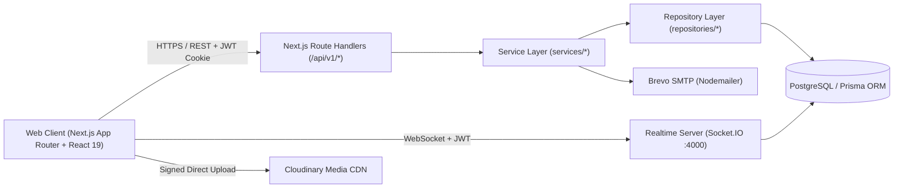

<div align="center">
  
  <h1>Poppin.</h1>
  <p><strong>The Social Identity, Community & Real-Time Collaboration Platform for Builders</strong></p>

  <p>
    
    
    
    
    
    
  </p>
</div>

---

## Overview

**Poppin.** unifies expressive builder portfolios, community feeds, and low-latency real-time messaging into a single full-stack web platform. Designed for software engineers, product designers, and tech creators, Poppin bridges the gap between static professional profiles and fragmented chat channels.

### Core Capabilities

- **Identity & Onboarding** — Instant `@username` availability checks, email/password registration with 6-digit OTP verification, Google OAuth 2.0, password recovery via Brevo SMTP, and a 3-step progressive onboarding flow.
- **Rich Builder Profiles** — Customizable profiles featuring headlines, bios, avatars, cover banners, skills, interests, external links, education, and work experience.
- **Social Graph & Safety** — Follow/unfollow mechanics, mutual connections, personalized peer suggestions, account privacy controls, user blocking, and abuse reporting.
- **Feeds, Engagement & Communities** — Multimedia posts backed by Cloudinary signed uploads, likes, saves, threaded comments, hashtag discovery, and moderated community hubs.
- **Real-Time Messaging & Presence** — Dedicated Socket.IO microservice (`realtime-server/`) powering 1-on-1 and group conversations, typing indicators, online presence, read receipts, and live notifications.

---

## Architecture

Poppin follows a **layered monolithic API + standalone real-time service** architecture. Business logic is isolated from HTTP transport and database persistence to keep endpoints predictable, testable, and easy to scale.



### Repository Layout

```text
.
├── app/                    # Next.js App Router pages, layouts, and /api/v1/* route handlers
├── components/             # Modular UI components (auth, feed, messaging, communities, layout)
├── context/                # React Context providers (AuthContext, Socket/Realtime state)
├── docs/                   # Architecture audits, integration contracts, and Postman collection
├── hooks/                  # Custom React hooks
├── lib/                    # Shared infrastructure (db, auth/jwt/otp, mail, validation, http)
├── prisma/                 # Prisma schemas (PostgreSQL & SQLite), migrations, and seed scripts
├── realtime-server/        # Standalone Socket.IO 4.x server for messaging & presence
├── repositories/           # Data-access layer abstracting Prisma queries
├── scripts/                # Database helpers, PostgreSQL seeding, and maintenance utilities
├── services/               # Domain business logic (auth, feed, community, messaging, etc.)
├── tests/                  # Phase contract tests, E2E integration, security audit, and unit tests
├── DESIGN.md               # Visual design system, tokens, and interaction standards
└── PRODUCT.md              # Product specification, user personas, and operating context
```

---

## Tech Stack

| Layer | Technology | Purpose |
| :--- | :--- | :--- |
| **Framework** | Next.js 15 (App Router), React 19 | SSR, routing, and REST API endpoints |
| **Language** | TypeScript 5.7 | End-to-end static type safety |
| **Styling & Motion** | Tailwind CSS 3.4, GSAP, Lucide Icons | Dark-first UI system and micro-interactions |
| **Database & ORM** | PostgreSQL (Neon), SQLite (local), Prisma 5.22 | Relational persistence & schema migrations |
| **Real-Time** | Socket.IO 4.8 (`realtime-server/`) | Bi-directional messaging, typing, and presence |
| **Authentication** | JWT (`jsonwebtoken`), `bcryptjs`, Google OAuth | Stateless cookie sessions & secure password hashing |
| **Transactional Email** | Nodemailer + Brevo SMTP (`smtp-relay.brevo.com`) | Account verification & password-reset OTP delivery |
| **Media & Storage** | Cloudinary, AWS S3 Client | Signed image/media uploads & CDN delivery |
| **Validation** | Zod 4 | Strict request payload & schema validation |

---

## Getting Started

### Prerequisites

- **Node.js** `>= 20.x`
- **npm** `>= 10.x`
- **PostgreSQL** database (e.g., [Neon](https://neon.tech)) or local SQLite for quick evaluation

### 1. Installation

```bash
git clone https://github.com/Happy-mandowara/POPPIN.git
cd POPPIN
npm install
```

### 2. Environment Configuration

Copy `.env.example` to `.env.local` and populate your credentials:

```bash
cp .env.example .env.local
```

| Variable | Required | Description |
| :--- | :---: | :--- |
| `DATABASE_URL` | Yes | PostgreSQL pooled connection string (or `file:./dev.db` for SQLite) |
| `DIRECT_URL` | Yes | Direct PostgreSQL connection string for Prisma migrations |
| `JWT_SECRET` | Yes | 64-byte hex secret (`openssl rand -hex 64`) |
| `JWT_EXPIRES_IN` | No | Token lifetime (default: `7d`) |
| `BREVO_SMTP_USER` | Yes | Brevo SMTP login (e.g. `xxxxxxx@smtp-brevo.com`) |
| `BREVO_SMTP_KEY` | Yes | Brevo SMTP relay key (`xsmtpsib-...`) |
| `BREVO_SENDER_EMAIL` | Yes | Verified sender email address in Brevo |
| `NEXT_PUBLIC_APP_URL` | Yes | Base web URL (e.g. `http://localhost:3000`) |
| `NEXT_PUBLIC_SOCKET_URL` | Yes | Socket.IO server URL (e.g. `http://localhost:4000`) |
| `NEXT_PUBLIC_CLOUDINARY_CLOUD_NAME` | Yes | Cloudinary cloud name for media uploads |
| `NEXT_PUBLIC_CLOUDINARY_API_KEY` | Yes | Cloudinary public API key |
| `CLOUDINARY_API_SECRET` | Yes | Cloudinary server secret for upload signatures |
| `GOOGLE_CLIENT_ID` | No | Google OAuth 2.0 client ID |
| `GOOGLE_CLIENT_SECRET` | No | Google OAuth 2.0 client secret |
| `GOOGLE_REDIRECT_URI` | No | OAuth callback URL (`/api/v1/auth/google/callback`) |

### 3. Database Setup

**PostgreSQL (Recommended / Production):**
```bash
npm run db:generate:postgres
npm run db:push:postgres
npm run seed
```

**SQLite (Local Development):**
```bash
npm run db:generate:sqlite
npm run db:push:sqlite
```

### 4. Running Locally

Start the Next.js application and the standalone Socket.IO server in separate terminals:

```bash
# Terminal 1: Next.js frontend & API (http://localhost:3000)
npm run dev

# Terminal 2: Standalone Socket.IO server (http://localhost:4000)
npm run realtime:dev
```

---

## API Design & Conventions

All REST endpoints are mounted under `/api/v1/` and return a standardized JSON envelope.

<details>
<summary><strong>Response Envelopes & Status Codes</strong></summary>

**Success Response**
```json
{
  "success": true,
  "data": {},
  "message": "Optional human-readable confirmation"
}
```

**Error Response**
```json
{
  "success": false,
  "error": {
    "code": "ERROR_CODE",
    "message": "Human-readable error description",
    "details": {}
  }
}
```

| Status | Meaning |
| :--- | :--- |
| `200 OK` | Successful retrieval or update |
| `201 Created` | Resource created |
| `400 Bad Request` | Zod validation failure or malformed parameters |
| `401 Unauthorized` | Missing, expired, or invalid session token |
| `403 Forbidden` | Ownership check failure or blocked interaction |
| `404 Not Found` | Resource or user does not exist |
| `409 Conflict` | Duplicate email, taken `@username`, or existing relation |
| `429 Too Many Requests` | Rate-limit threshold exceeded |
| `500 / 502` | Unexpected server or upstream service error |

</details>

### API Domains

- **Auth** (`/api/v1/auth/*`) — Registration, email OTP verification, login, Google OAuth, password recovery, session inspection, logout.
- **Profiles & Usernames** (`/api/v1/profiles/*`, `/api/v1/users/me/profile/*`, `/api/v1/usernames/availability`) — Profile CRUD, skills, interests, links, education, experience, handle availability.
- **Onboarding** (`/api/v1/onboarding/*`) — Multi-step onboarding state, peer suggestions, completion.
- **Social Graph & Safety** (`/api/v1/users/*`) — Follow/unfollow, followers/following lists, account & privacy settings, block/unblock, reporting.
- **Posts, Feed & Engagement** (`/api/v1/posts/*`, `/api/v1/feed/*`, `/api/v1/comments/*`, `/api/v1/explore/*`) — Post publishing, algorithmic/following feeds, likes, bookmarks, comments.
- **Communities & Groups** (`/api/v1/communities/*`, `/api/v1/groups/*`) — Community creation, membership requests, moderation, community feeds.
- **Messaging & Notifications** (`/api/v1/conversations/*`, `/api/v1/notifications/*`) — Conversation history, unread counts, notification feeds.
- **Media & Search** (`/api/v1/media/*`, `/api/v1/cloudinary/*`, `/api/v1/search/*`) — Signed upload signatures and global search across users, posts, and communities.

An importable Postman/Insomnia collection is available at [`docs/poppin-api-collection.json`](./docs/poppin-api-collection.json).

---

## Testing & Quality Assurance

```bash
# TypeScript static type check
npx tsc --noEmit

# Linter
npm run lint

# Full test suite (Contracts, Phases 1-7, E2E, Security Audit, Realtime)
npm test

# Mail & OTP unit tests
npx tsx tests/mail-otp.test.ts

# Socket.IO realtime integration tests
npm run realtime:test
```

---

## Production Build & Deployment

The project is configured for zero-config **Vercel** deployments (Next.js app) paired with **Railway** or **Render** (standalone `realtime-server/`):

```bash
# Generates Prisma Client and builds the Next.js production bundle
npm run build
npm start
```

> [!NOTE]
> `package.json` runs `prisma generate` during both `postinstall` and `build` so cached serverless builds always ship an up-to-date Prisma Client.

---

## Related Documentation

- [`DESIGN.md`](./DESIGN.md) — Design system, color tokens, typography, and UX axioms
- [`PRODUCT.md`](./PRODUCT.md) — Product positioning, personas, and capability matrix
- [`docs/developer-2-integration.md`](./docs/developer-2-integration.md) — Cross-module integration contracts
- [`docs/poppin-api-collection.json`](./docs/poppin-api-collection.json) — API collection for Postman / Insomnia
